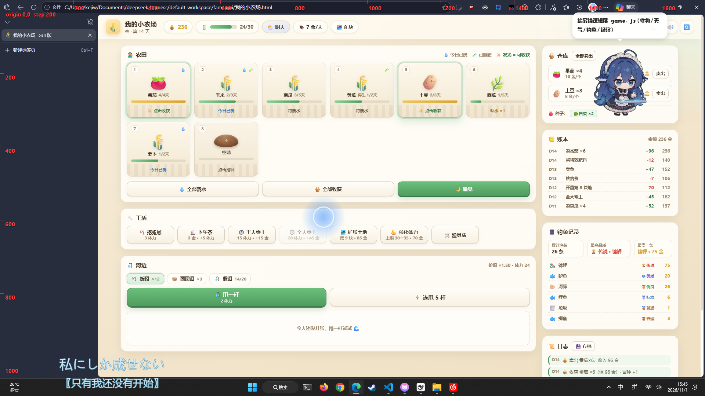

# 我的小农场 · GUI 版

把 `skills/farm-game/SKILL.md` 里的文字种田游戏做成了可以直接玩的网页界面。
纯前端、零依赖、无需联网，双击 HTML 就能玩。



## 打开方式

| 方式 | 文件 | 说明 |
|---|---|---|
| 单文件版 | `我的小农场.html` | 推荐。CSS/JS 全部内联，拷到哪都能玩 |
| 开发版 | `index.html` | 拆分成 `game.js` / `ui.js` / `style.css`，改代码用这个 |

双击即可，浏览器打开 `file://` 也能跑（无需起服务器）。
存档写在浏览器 `localStorage`，也可导出 `.json` 备份 / 换设备导入；想清档访问 `index.html#fresh`。

## 界面

- **顶栏**：金币、体力、天气（悬停看当天效果）、伙食费、地块数；右侧是 **🌙 睡觉**、**📊 状态**（累计数据）、**⚙️ 设置**（规则说明 / 导入导出 / 音效 / 重新开始）
- **农田**（左栏）：默认 5 块地，5 列 × 约 3 行可见，更多地块面板内滚动
  - 点空地 → 选种播种；点生长中的地 → 浇水 / 施肥 / 铲除
  - **成熟的地块左键直接收获**（少点一次）；右键或 Shift + 点击打开详情
  - 成熟的地会呼吸式发光，写「点击收获」；刚浇成熟则写「明天可收」
  - 底部四连：**全部播种** / **全部施肥** / 全部浇水 / 全部收获
- **河边**（左栏）：选饵料 → 甩一杆 / 连甩 5 杆；下方列出最近 5 条渔获（含品质和估值）
- **🧺 仓库**（左栏）：作物、渔获、蚯蚓、肥料；右上角显示**货物总价**，蚯蚓和肥料只做展示（蚯蚓去渔具店卖、肥料去种子店卖）
  - 作物按品质分桶存放，每行显示「标准 3 · 优良 2 · 均 8.4 金」和合计价
- **🔧 干活**（右栏）：挖蚯蚓、打零工（**每天只能打一次**；体力满自动全天 ×2.0，否则半天 ×1.2）
- **🏡 农场**（右栏）：下午茶、扩张土地、强化体力、**🚿 洒水器**（60 金/个）、**🤖 自动收获器**（160 金）；设备每周要交维护费（洒水器 2 / 渔网 2 / 收获器 4）
- **🏪 商店**（右栏）：种子店（种子 + 肥料，都能半价卖回）、渔具店（饵料 + 收蚯蚓）
- **📋 今日委托**（右栏）：每天 3 单（2 个作物单 + 1 个鱼单），仓库/渔获攒够就能交，报酬高于直接卖；交鱼会挑最便宜的，好鱼留给自己
- **右栏其余**：账本（按天折叠）、钓鱼记录本、日志（按天折叠，可导出 `.md`）

快捷键：`Esc` 关弹窗；地块 / 饵料 / 账本与日志的每日行都可用 `Tab` 聚焦、`Enter` / 空格 操作。

## 规则实现（对齐 SKILL.md）

- 默认 **5 块地**；扩张 40 金起，每块 +15
- 生长按**浇水天数**推进；成熟当天不能收，**次日**才可收
- 产量 = 基础 ±1 − 漏浇天数 + 施肥加成（最低 1）；大作物固定 1
- 收获 30% 留种；种子进背包，多收作物只在最后一收判定
- 经济：强化 30 金起、**每级 ×1.2**（36/43/52…），每次 +5 体力上限；伙食费随上限 3→7 金
- 种子只能店里买，卖回价 = 买价的一半；播种不自动买种

### 作物与种子价（已平衡）

| 作物 | 买价 | 生长 | 产量/块 | 单果 | 季节 | 利润/天 |
|---|---|---|---|---|---|---|
| 🥕 萝卜 | 5 | 2 天 | 3 | 4 | 春·秋 | 3.5 |
| 🥬 白菜 | 7 | 2 天 | 2 | 8 | 春·秋 | 4.5 |
| 🥬 菠菜 | 6 | 2 天 | 2 | 7 | 春·秋 | 4.0 |
| 🥔 土豆 | 9 | 3 天 | 3 | 8 | 春·夏 | 5.0 |
| 🍠 红薯 | 12 | 4 天 | 4 | 10 | 秋 | 7.0 |
| 🌽 玉米 | 14 | 3 天 | 2 | 16 | 春·夏 | 6.0 |
| 🍆 茄子 | 17 | 4 天 | 2 | 22 | 夏·秋 | 6.8 |
| 🍅 番茄 | 19 | 4 天 | 3 | 16 | 夏·秋 | 7.3 |
| 🌶️ 辣椒 | 20 | 4 天 | 3 | 21 | 夏·秋 | 10.8 |
| 🎃 南瓜 | 26 | 5 天 | **1** | **110** | 秋 | **16.8** |
| 🍉 西瓜 | 36 | 5 天 | **1** | **140** | 夏 | **20.8** |
| 🥒 黄瓜 | 19 | 3 天 + 再生 2×2 天 | 共 6 个 | 13 | 夏 | 8.4 |
| 🍇 葡萄 | 26 | 4 天 + 再生 2×2 天 | 共 9 个 | 12 | 夏 | 10.3 |
| 🍓 草莓 | 22 | 3 天 + 再生 1×3 天 | 共 9 个 | 9 | 春 | 9.8 |

> 表里是基础价（不含等级 / 肥料）。**南瓜与西瓜一株只结 1 个，不吃等级和产量肥料，只吃肥料的品质加成**
> —— 施肥只提高品质档位；其余作物每 4 级 +1 个、施肥再 +1/+2 个。
> 实际售价 = 基础价 × 品质倍率（平均 ×1.03，施肥后 ×1.26 / ×1.39）。
> **季节**：只有当季的作物能买种子、能播种；换季不会影响已经种下的作物。

### 季节

- 每 30 天换一季：**春 1–30 / 夏 31–60 / 秋 61–90 / 冬 91–120**，然后循环
- 种子店只卖当季种子，非当季的种子买不到也种不下
- **冬天土地封冻、河面结冰**：不能播种、不能钓鱼，渔网也收不到鱼；只能打工、卖库存、交委托
- 已经在地里的作物照常生长、照常成熟

| 季节 | 特点 |
|---|---|
| 🌱 春 | **多雨**（雨天 50%，自动浇水） |
| ☀️ 夏 | **多晴**（晴天 60%）· **浇水要 2 体力**（其他季节 1 点） |
| 🍂 秋 | **丰收**：普通作物每次收获 **+1 个**（大作物不算） |
| ❄️ 冬 | 会**下雪**（45%，化雪等于自动浇水）· 不能种也不能钓 |

### 市场价格

卖作物 / 鱼时价格不是固定的：

- **供需（作物与鱼都算）**：最近卖得越多越便宜——作物每件 −2%、鱼每条 −1.5%，最低 ×0.75；
  一天不卖回落 20%，没卖过的作物是 ×1.05（稀缺）
- **季节（只有作物有）**：**反季 ×1.20**（过季稀缺、卖得贵），**当季 ×1.00**（满大街都是）
- 最终价 = 基础价 × 品质 × 8 折（商店）/ 100%（收购箱）× 成就加成 × 市价
- 仓库和农产品店都会直接标出「市价 ×1.18 · 反季 · 平稳」
- 所以别把同一种菜一次性全砸出去；**囤到反季再卖价格更高**（但反季卖太多一样会饱和）

| 最近销量 | 当季 | 反季 |
|---|---|---|
| 0 件 | 1.05 | 1.26 |
| 3 件 | 0.99 | 1.19 |
| 10 件 | 0.85 | 1.02 |
| 20 件+ | 0.75 | 0.90 |

- **鱼的市价只看供需**（每条 −1.5%，最低 ×0.75），鱼没有季节差价
- **商店买价也吃市价**：水产店 = 基础价 ×1.8 × 鱼市价，农产品店 = 售价 ×1.8 × 作物市价（越稀缺越贵）
- **杂物和宝箱不受市价影响**（收购箱按原价 × 成就加成结算）
- 点商店面板的 **📈 行情** 能看到当前所有作物 / 水产的系数、销量和状态

### 钓鱼

- 2 体力 + 1 饵；蚯蚓优先，假饵留最后
- **鱼汛**：每种鱼只在特定季节成群——汛期上钩权重 ×1.25，非汛期 ×0.3
  （鲫鱼 春·秋 / 鲤鱼 春夏秋 / 鳜鱼 春·夏 / 鲈鱼 夏·秋 / 河豚 秋 / 锦鲤 春）
- **蚯蚓**：品质取两次较好的 + 好鱼上钩 ×1.3，**不再加成售价**；挖一次 1–3 条（晴天 −1、阴雨 +1），只能去渔具店卖 3 金/条
- **天气只影响上钩概率**，不影响价格：晴天好鱼 ×0.8 / 杂物 ×1.4，阴天 ×1.0，雨天好鱼 ×1.3 / 杂物 ×0.6
- 挖蚯蚓：3 体力挖 2–4 条（晴天 −1、阴雨 +1），挖到的蚯蚓也能按 2 金/条卖
- 品质 7 档 0.4x~3.0x；估值 = 基础价 × 品质倍率
- **渔获先进仓库**，卖出才换钱（分组卖或全部卖出）

### 每日委托

- 每天 3 单：2 个作物单 + 1 个「任意鱼」单，睡一觉自动换新，每天还能手动刷新一次，没交的单不惩罚
- **杂物、宝箱不计入鱼单**，交鱼只收正经鱼
- 报酬 = 数量 × 单价 × **1.35**，比直接卖多约 35%
- 委托池按天逐档解锁：D1 只有萝卜/白菜/土豆，D3 / D5 / D7 / D9 / D12 / D15 各加一种，D18 起全开
- 越贵的作物被点单的权重越高（萝卜 1 份权重、西瓜 6 份），便宜菜不再天天刷屏
- 季节每 30 天推进一次：数量 ×1 / 1.6 / 2.2 / 2.8，鱼单单价 11 / 15 / 19 / 23
- 交鱼时自动挑**最便宜**的 N 条，锦鲤/河豚这类好鱼留着做图鉴

### 作物品质

作物和鱼共用同一套 7 档品质（劣质 0.4× → 传说 3.0×），**收获时判定**：

| 情况 | 品质取几次最好 | 平均倍率 |
|---|---|---|
| 不施肥 | 1 次 | ×1.03 |
| 普通肥（8 金 / +1 产量） | 2 次 | ×1.26 |
| 特效肥（18 金 / +2 产量） | 3 次 | ×1.39 |

- 单价 = 基础价 × 品质倍率，最低 1 金；仓库按品质分桶，卖的时候一次结清
- 多次收获作物（黄瓜/草莓）吃肥料只提品质、不加产量
- 交委托时**先扣品质差的**，好东西留着自己卖
- 老存档的数字仓库会自动迁移成「标准」品质

## 房规（玩家追加）

| 规则 | 说明 |
|---|---|
| 默认农田 | 开局 5 块地、体力上限 15，扩张价从 40 金起 |
| 打零工 | 半天/全天合并，**每天只能打一次**：体力满自动全天（×2.0），否则半天（×1.2），不够半天就用光剩余体力 |
| 种子店 | 种子和肥料都只能店里买；卖回价 = 买价的一半；播种不再自动买种 |
| 全部播种 / 施肥 | 一键铺满空地 / 给所有可施肥地块施肥，资源不够就停 |
| 账本、日志 | 都按天折叠，点某一天展开明细 |
| 天气 | 去掉暴风雨；晴 45% / 阴 30% / 雨 25%，只影响上钩概率 |
| 蚯蚓 | 只影响品质与上钩；不加价；挖一次 1–3 条（晴 −1 / 阴雨 +1），3 金/条，只能在渔具店卖 |
| 肥料 | 种子店买（8 / 18 金），进仓库，施肥时消耗；半价回收 |
| 洒水器 | 80 金/个，每天自动浇 1 块地、不耗体力，最多每块地一个 |
| 铲除 | 地块详情里可铲除作物，不返还种子/金币 |
| 存档 | 自动存 localStorage；顶栏 ⬇️/⬆️ 导入导出 `.json`；日志可导出 `.md` |
| 每日委托 | 每天 2 作物单 + 1 鱼单，报酬 1.35× 直售，单张最低 40 金；委托池按天数逐档解锁，且只会要玩家买得到的作物 |
| 长期订单 | 5 天期限、数量大、**2 倍报酬**，完成或过期后自动换新 |
| 水产店 | 渔获直接出售处（**8 折**，支持自定义卖出数量）；每天进货（一般品质），每种鱼库存随机、睡觉补货；买来的鱼不能交委托 |
| 农产品店 | 作物直接出售处（**8 折**，支持自定义卖出数量）；每天进货（一般品质），买价 = 售价 ×1.8 |
| 收购箱 | 仓库每行点 📦 一键整批放入，**下次睡觉按原价（100%）结算**；可取指定批次 / 全部取出 |
| 仓库 | 只展示（作物/渔获带一句话简述），**不提供任何出售**；卖东西分别去农产品店 / 水产店 / 渔具店 / 种子店 |
| 等级 | 种田 / 钓鱼各 10 级：种田每 5 级 +1 产量，钓鱼每级咬钩 +1%（≤8%）、好鱼 +2%（≤18%） |
| 等级解锁 | 玉米 Lv2 / 茄子番茄 Lv3 / 黄瓜草莓 Lv4 / 南瓜 Lv5 / 西瓜 Lv6；洒水器 Lv2、特效肥 Lv4、自动收获器 Lv6；渔网 钓鱼 Lv2，上限 2+等级（≤9） |
| 商店进货 | 水产店每天 3–6 条常见鱼，河豚 D20、锦鲤 D30 起；农产品店每天 3–7 个便宜菜，南瓜 D18、西瓜 D24 起 |
| 税 | 每 30 天一次，按（金币 + 仓库价值 + 收购箱）累进：2% / 4% / 6%，最低 30 金 |
| 成就 | 36 项，分种田 / 钓鱼 / 经营 / 收集；每项给**成就点**，每 10 点 +1% 售价（最多 +20%） |

## 与技能文档不一致时的取舍

原 `SKILL.md` 与 `我的小农场-存档.md` 有几处规则漂移（雨天钓鱼 +30% vs 减半、黄瓜草莓售价不同等）。
本实现**一律以 `SKILL.md` 为准**，并补了文档没写清的细节（再生期沿用首次单价、天气/蚯蚓只作用在上钩概率与品质上）。

## 开发者命令

```bash
node selftest.cjs      # 300 项逻辑自测：播种/种子店/肥料/品质/收获器/钓鱼/天气/经济/委托/等级/解锁/农产品店/水产库存/成就/税金/存读档/3000 步压测
node check-ui.cjs      # 校验 ui.js 用到的 id、data-act 在 index.html 里都存在
node dom-test.cjs      # DOM 冒烟：用最小 DOM 桩把 ui.js 跑起来，测渲染与弹窗
node balance.cjs       # 数值体检：钓鱼期望 / 三种活计收益 / 委托样本 / 设备回本 / 套利检查
node analysis.cjs      # 收益分析：作物 / 钓鱼 / 渔网 / 设备回本 / 早中后期日净收入
node build-single.cjs  # 把三件套内联成 我的小农场.html
```

## 更新记录

**v2.7.0（鱼汛 / 行情面板 / 商店买价吃市价）**

- **鱼汛**：每种鱼只在特定季节成群，汛期权重 ×1.25、非汛期 ×0.3（鲫鱼春秋、鲤鱼三季、鳜鱼春夏、鲈鱼夏秋、河豚秋、锦鲤春）
- **📈 市场行情面板**：商店面板新增按钮，列出全部作物 / 水产的市价系数、最近销量、稀缺状态与买价
- **商店买价也受市价影响**：水产店 / 农产品店的进货价 = 基础价 ×1.8 × 市价
- **杂物和宝箱不吃市价**：收购箱按原价 × 成就加成结算，也不计入销量
- 为补偿鱼汛带来的期望下降，河豚 6→9、锦鲤 4→6、鲈鱼 10→11
- 测试 373 项 + DOM 45 项

**v2.6.0（反季溢价 / 渔获合并 / 长期订单提前奖励）**

- **季节价反转**：反季 **×1.20**（稀缺、卖得贵）、当季 **×1.00**；囤到反季卖更划算
- **渔获按鱼种合并**：同一种鱼的不同品质合成一行（和作物一样），显示品质构成与均价，卖出时先卖差的
- **鱼也有市价**：每条 −1.5%，最低 ×0.75，隔天回落 20%；鱼没有季节差价
- **长期订单提前交货奖励**：每提前 1 天 **+10%**，最多 **+50%**，面板上直接显示「今天交 +X 金」
- 收购箱的渔获条目也带品质明细，取回后品质不变
- 测试 367 项 + DOM 45 项

**v2.5.0（四季特点 / 市场价格 / 雪天）**

- **四季特点**：春多雨（50%）、夏多晴（60%）且**浇水 2 体力**、**秋天收获 +1 个**、冬天新增 **❄️ 雪天**（45%，化雪自动浇水）
- **市场价格波动**：卖得越多越便宜（每件 −2%，最低 ×0.75，隔天回落 20%），没卖过的作物 ×1.15
- **季节溢价**：当季 ×1.15、反季 ×0.90；仓库和农产品店直接显示「市价 ×1.18 · 当季 · 平稳」
- 百货店**只收宝箱、不收杂物**（杂物只能进收购箱）
- 修：南瓜 / 西瓜其实可以施肥（只提品质），之前被误拦掉了
- 测试 358 项 + DOM 45 项

**v2.4.0（季节系统 / 14 种作物 / 小修）**

- **季节系统**：每 30 天春→夏→秋→冬；**种子店只卖当季种子**，非当季的买不到也种不下
- **冬天土地封冻、河面结冰**：不能播种、不能钓鱼，渔网也收不到鱼（打工 / 卖库存 / 交委托照常）
- **作物扩到 14 种**：新增 🥬 菠菜（春秋）、🍠 红薯（秋）、🌶️ 辣椒（夏秋）、🍇 葡萄（夏，多次收）
- 每种作物标了季节，播种弹窗里非当季的卡片会置灰并标「非当季」
- 肥料改回原样：普通肥 / 特效肥品质都是取 2 次最好
- 宝箱开出的饵料数量下调（面团 4–6、蚯蚓 5–7；金箱蚯蚓 8–10）
- 水产店**不再收任何杂物**（按名字兜底，老存档的杂物也不会漏进去）
- 茶叶上架提前到 **D1 / D5 / D10 / D16**
- 修假饵耐久显示：从写死的 `25/20` 改成 `当前/25`
- 成就「五谷丰登」改成 14 种作物、全图鉴改成 7 鱼 + 14 作物
- 测试 347 项 + DOM 45 项

**v2.3.0（百货店 / 宝箱 / 全体力钓鱼 / 数值重做）**

- **大作物重做**：南瓜 / 西瓜改成**一株 1 个**，价格 110 / 140，种子 26 / 36 —— 单颗高价，5 天一茬
- **大作物只吃肥料品质加成**：数量固定 1 个，不吃等级和产量肥料；施肥把品质档位拉高（普通肥取 2 次、特效肥取 3 次最好）
- **产量曲线 floor(lv/5) → floor(lv/4)**：Lv4 +1、Lv8 +2，Lv6–9 的空窗从 4 级缩到 1 级
- **委托保底**：每天第一张单固定是「买得到的最贵作物」，中期不再全是白菜单
- **钓鱼等级重做**：2 杆 1 点经验（满级 ~26 天），咬钩最多 +10%、好鱼最多 +22.5%
- **维护费再压一档**：31 块以上 10 → **14 金/周**（36 地满配 329/周 = 4.4%）
- **全体力钓鱼**：河边「🎣 甩一杆 / ⚡ 连甩 5 杆 / 🌊 全部体力」改成**一行三个**
- **新增百货店**：卖茶（绿茶 / 红茶 / 奶茶 / 咖啡）、卖钥匙、**回收杂物与宝箱**
- **茶叶定价**：12 / 17 / 24 / 30 金，回 4 / 6 / 9 / 12 体力（2.5~3.0 金/体力，大杯更划算）
- **下午茶改版**：不再扣 3 金，改成**消耗一份茶**，一天一杯
- **宝箱分三级**：木制（直接开 10–26 金）/ 铁制（Lv4，铁钥匙 40，一包物资约 80 金）/ 黄金（Lv7，金钥匙 120，200–320 金 + 高级物品）
- **水产店不再收购杂物和宝箱**，改由百货店回收；**收购箱改成什么都收**（含杂物和宝箱，原价结算）
- 新增成就：下午茶 10 / 30 次、开宝箱 10 / 30 个，成就总数 **43**
- 规则说明补全：大作物、肥料品质、宝箱、百货店、收购箱、等级新曲线
- 测试 332 项 + DOM 45 项

**v2.2.0（等级露出 / 委托与维护费调整 / 成就奖励回归）**

- 收购箱自定义取出**支持选择物品**（下拉选批次 + 数量）
- 农田面板显示**种田等级**、河边显示**钓鱼等级**（hover 看经验）
- 水产店支持**自定义卖出**（选鱼种 + 数量）
- 种子店去掉「· 卖回价是买价的一半」
- **委托优化**：贵作物一次要 2–3 个，单张报酬**最低 40 金**
- **维护费分段**：6–20 块 3 金/周、21–30 块 6 金/周、31 块以上 10 金/周（36 地 165/周）
- **收购箱纳入成就**（出货 100 / 500 件、箱收益 5000），成就总数 39
- **成就恢复实质奖励**：点数 + 金币 / 种子 / 肥料 / 饵料
- 测试 300 项 + DOM 34 项

**v2.1.0（交互细节）**

- 收购箱：**放入回到一键整批**（点 📦 直接进箱），**取出支持自定义数量**（保留「全部取出」）
- 渔具店去掉「· 这里可以卖」「· 只有这里收」两处冗余提示
- 水产店 / 农产品店标题只留金币数，不再重复「只能在这里出售（80 折）」
- 农产品店按钮副标题「唯一收购作物」→「买卖作物」
- 河边的最近渔获改为**单行横排**（一行 5 个，省一半高度）
- 测试 292 项

**v2.0.0（长期订单 / 成就点 / 细节打磨）**

- **委托池按等级裁剪**：只会要玩家当前等级买得到的作物，不再出现“看得到接不了”的单
- 新增**长期订单**：5 天期限、数量大、2 倍报酬，面板置顶显示，完成或过期自动换新
- **收购箱**支持自定义放入数量、支持「全部取出」放回仓库
- **农产品店**支持自定义卖出数量；买价 2.2× → **1.8×**（凑单不再离谱）
- **成就奖励改为成就点**：每 10 点 +1% 售价（最多 +20%，作用于商店与收购箱），不再直接发金币/道具
- 文案：农产品店「只能在这里卖」→「在这里出售」
- 测试 291 项 + DOM 31 项

**v1.9.0（收购箱 / 8 折收购 / 细节打磨）**

- 新增**收购箱**：仓库每行点 📦 整批放进去，**下次睡觉按原价（100%）结算**
- **水产店 / 农产品店直接收购降到 8 折**——急用钱走商店，不急就进收购箱
- 农产品店买作物、仓库作物都显示**一句话简述**（不再显示「卖回去只值 X 金」）
- 水产店卖渔获不再附带「自己钓的 / 今天买进的」标签
- 未解锁的水产 / 作物**不再显示「买3」**（只留「未解锁」）
- 蚯蚓支持**自定义出售数量**（1–999）
- 成就新增 4 项：挖蚯蚓 50 / 200 次、打零工 30 / 100 次（共 36 项）
- 睡觉播报不再提示「委托换新」「商店补货」
- 收购箱里的货计入税金基数，不能用来避税
- 测试 279 项 + DOM 25 项

**v1.8.0（等级门槛 / 商店进阶）**

- 商店**库存变大**：水产店鲫鱼/鲤鱼 3–6 条，农产品店便宜菜 3–7 个
- **高级货物中后期才进货**：水产店河豚 D20、锦鲤 D30；农产品店南瓜 D18、西瓜 D24
- **高级种子与种田等级挂钩**：玉米 Lv2、茄子/番茄 Lv3、黄瓜/草莓 Lv4、南瓜 Lv5、西瓜 Lv6（未解锁不能买）
- **设备等级解锁**：洒水器 种田 Lv2、自动收获器 种田 Lv6、特效肥 种田 Lv4
- **渔网与钓鱼等级挂钩**：钓鱼 Lv2 解锁，上限 = 2 + 钓鱼等级（Lv7 起封顶 9 张）
- **降低等级加成**：种田每 5 级 +1 产量（Lv5/Lv10）；钓鱼每级咬钩 +1%（最多 +8%）、好鱼 +2%（最多 +18%）
- 仓库面板不再显示「去农产品店 / 水产店出售」提示
- 测试 270 项 + DOM 21 项

**v1.7.0（等级 / 农产品店 / 累进税 / 成长线）**

- 新增**种田等级、钓鱼等级**（Lv1–10）：收获涨种田经验、钓到鱼涨钓鱼经验（完美 +3）；种田每 3 级 +1 产量，钓鱼每级咬钩 +1.5%、好鱼权重 +3%
- 新增**农产品店**：作物**只能在这里卖**（仓库不再直接出售任何东西）；每天进货（一般品质），买价是售价的 2.2 倍
- 水产店买鱼不再写「不能交委托」，改成每条鱼的**一句话简述**（规则页里仍保留这条限制）
- **税金改为累进**：按（金币 + 仓库）0~2k 收 2%、2k~1w 收 4%、1w 以上收 6%，最低 30 金；状态页显示下次缴税还有几天
- **委托池加过渡档**：D1 只有 3 种菜，D3 / D5 / D7 / D9 / D12 / D15 各加一种，D18 全开；越贵的作物权重越高
- **鱼单单价随季节涨**：11 → 15 → 19 → 23 金/条
- 自动收获器 **200 → 300 金**；假饵**耐用 20 → 25 次**；面团饵支持**自定义购买数量**（1–999）
- **初始体力 10 → 15**（伙食费相应 3 → 4 金/天）
- 成就 **20 → 32 项**（新增等级、农产品、长期经营类）
- 状态页删去「最高品质 / 最贵一条」，改为等级进度与税金倒计时
- 测试 246 项 + DOM 18 项

**v1.6.0（水产库存 / 成就 / 收益分析）**

- 仓库的渔获不再写「水产店卖」，改成**一句话简述**（鲫鱼肉嫩刺多、锦鲤好运象征…），杂物也有各自描述
- 水产店改为**商品库存制**：每种鱼每天随机进 0–4 条（越稀有越少）、卖完等明天、睡觉自动补货；买来的鱼是**一般品质**
- 新增 **20 项成就**（种田 7 / 钓鱼 6 / 经营 6 / 收集 1），达成即自动发放金币、种子、肥料或饵料；顶栏 🏆 可看进度条
- 老存档读入时自动补进货表、成就为空，不会白送
- `balance.cjs` 增加「三种活计金/体力」与「前中后期委托样本」，用来复现收益分析
- 规则页 / 状态页 / 说明同步；测试 219 项 + DOM 14 项

**v1.5.2（规则回调 / 细节修复）**

- 假饵回退到 v1.4 数值：好鱼 ×1.15、品质单次判定——仍是「省饵、少杂物、会空军」的定位
- 委托**每天自动换新**，另外每天还能**手动刷新一次**
- 渔网：**70%** 概率、只网到标准及以下品质的普通鱼，**不出杂物/宝箱**
- 普通肥与特效肥的**品质加成一致**（产量仍 +1 / +2）
- 水产店不再出售宝箱
- 修复连甩 5 杆失败时连弹两次提示
- 修复黑夜模式下日志 / 账本展开时的浅色底
- 设置里移除「查看状态」（顶栏 📊 保留）
- 规则页同步更新；测试 198 项 + DOM 11 项

**v1.5.1（规则修复 / 工程化）**

- 修复：仓库「全部卖出」不再顺手卖渔获，渔获只能去水产店
- 修复：水产店买来的鱼**不能交委托**（堵住买 5 金卖 11 金的无限套利）
- 睡觉播报合并成一条（「🌙 第 30 天 · 雨天 ｜ 伙食 −21 · 维护 −128 · 税 −400」），不再截断
- 假饵加强：品质取两次较好 + 好鱼权重 ×1.6，期望反超面团饵（代价是 28% 空竿）
- 税金改为按（金币 + 仓库价值）× 4%，最低 30 金，防止「睡前把钱花光」避税
- 委托卡片显示「约 N 金/个」；统计扩展到 30 天并新增按项目（委托/渔获/作物/打工/伙食/税金/维护/采购）分布
- 工程：新增 BALANCE 数值表、balance.cjs 体检、dom-test.cjs DOM 冒烟、GitHub Actions CI

**v1.5.0（水产店 / 统计 / 税金）**

- 新增 **🐟 水产店**：渔获只能在这里出售（仓库只展示），也能按基础价 1.8 倍买鱼来凑委托
- 新增 **📈 统计**（账本右上角）：最近 14 天收支柱状图 + 总收入 / 总支出 / 净收益 / 最赚的一天
- 新增 **🏛️ 月度税金**：每 30 天按金币 5% 收税（最低 20 金），和伙食费分开记账
- 状态页新增「维护费（每周）」和「税金（每 30 天）」两行
- 设备调价：洒水器 80、自动收获器 200、渔网 80（上限 9 张）
- 设备周维护费改为：洒水器 3 / 渔网 3 / 收获器 5
- 测试 185 项

**v1.4.0（钓鱼重做 / 图鉴统计）**

- **真正的空竿**：先判定咬钩，再抽鱼种。面团饵 92%、蚯蚓 95%、假饵 72%，晴天 −12%、雨天 +8%
- 天气现在影响**咬钩率**，不再改鱼种权重
- 假饵重做：杂物权重 ×0.3（不再是一堆垃圾）、好鱼 ×1.15，代价是 28% 空竿
- 蚯蚓：好鱼权重 ×1.35、品质取两次较好，咬钩 95%
- 设备降价并新增**周维护费**：洒水器 150→60、收获器 300→160、渔网 120→70（65% 上鱼）
- 委托报酬稳定为直售的 **135%**（不再随季节摊薄）
- 图鉴升级：首次捕获日、鱼种完成率 x/8、完美品质条数、鱼类/作物累计总价值；老存档自动回填
- 睡觉播报不再截断（最多 6 条），设备/土地维护费都能看到
- 25 块之后扩展费改为每块 ×1.6（原来 ×2.2 到 36 块时已经上百万）
- 设置里移除图鉴入口（顶栏 📖 已有）

**v1.3.0（自动化 / 图鉴 / 黑夜）**

- 自动收获器支持**开 / 关**（农场面板点一下切换）
- 新增 **📖 图鉴**：8 种鱼、10 种作物的捕获/收获次数与最好品质（钓鱼记录面板入口）
- 新增 **🌙 黑夜模式**：设置里切换，记住选择
- 春季（第 30 天）之后委托需求逐季放大：夏 ×1.6 / 秋 ×2.2 / 冬 ×2.8
- 新增 **🕸️ 渔网**（渔具店 120 金，最多 6 张）：每天耗 1 份面团饵，55% 概率各上 1 条鱼
- **5 块地之后每周收维护费**（每多一块 3 金/周），10 块地每周 15 金
- **25 块地之后扩展费暴涨**：第 26 块 715 金、第 27 块 1573 金（每块 ×2.2）
- 测试 168 项全过

**v1.2.0（自动化 / 设置）**

- 新增 **🤖 自动收获器**（300 金）：睡觉时自动收走成熟作物，不耗体力
- 委托改成**手动刷新**（每天一次），睡觉不再自动换单
- 仓库标题显示**货物总价**（作物按品质 + 鱼 + 蚯蚓 + 肥料折价）
- 没钱吃饭只恢复到**上限的 30%（至少 5 点）**
- 肥料只能在种子店卖；仓库的蚯蚓 / 肥料只做展示
- 顶栏精简为 **睡觉 / 📊 状态 / ⚙️ 设置**，规则说明、导入导出、音效、重开都收进设置
- 新增 **📊 状态页**：进度、体力、土地、设备、仓库总价、累计播种/收获/钓鱼/挖蚯蚓/委托

**v1.1.0（洒水器 / 经济整理）**

- 新增 🚿 **洒水器**：150 金/个，每天自动浇 1 块地、不耗体力，最多每块地一个
- **打零工每天只能打一次**，睡一觉才能再打
- 肥料改为**种子店购买 + 进仓库 + 半价回收**（普通 8 金、特效 18 金）；施肥消耗库存而不是现金
- 蚯蚓：挖一次 1–3 条（晴天 −1、阴雨 +1），价格 3 金/条，**只能在渔具店卖**
- 钓鱼委托**不再收杂物和宝箱**，交鱼只认正经鱼
- 新增**导出账本**（.md，按天汇总 + 明细 + 累计净收益）
- 种子店加「卖出全部种子」；规则页重排为分区卡片

**v1.0.0（作物品质）**

- 作物接入品质系统：收货时判定 7 档（0.4×~3.0×），仓库按品质分桶，卖出逐档结算
- 施肥从「只加产量」变成「加产量 + 拉高品质」：普通肥取 2 次最好、特效肥取 3 次最好
- 多收作物（黄瓜/草莓）施肥后只提品质，不加产量
- 仓库面板显示品质构成与均价；交委托时先扣品质差的
- 老存档自动迁移：数字仓库 → 「标准」品质，不需要手动删档

**v0.9.0（每日委托）**

- 新增「📋 今日委托」右栏面板：每天 2 个作物单 + 1 个「任意鱼」单，睡一觉刷新
- 报酬约比直接卖高 40%，没交的单不惩罚；委托池随天数解锁（前 4 天只要便宜菜）
- 交鱼自动挑最便宜的，锦鲤/河豚留着做图鉴
- 睡觉的播报改成逐条弹出（伙食费 / 天气 / 自动浇水 / 委托刷新）

**v0.8.0（平衡 + 修复）**

- 零工收益 全天 ×1.5 → **×2.0**、半天 ×1.0 → **×1.2**（不再被钓鱼碾压 3 倍）
- 草莓种子 30 → **22**、黄瓜 24 → **19**：多收作物重新回到「单日收益最高」的位置
- 天气开始真正影响收益：晴天杂物权重 ×1.4、雨天 ×0.6，晴雨期望差从 7% 拉到约 20%
- 挖蚯蚓 1–3 → **2–4** 条，蚯蚓路线不再纯亏
- 强化体力改为超线性（每级 ×1.2），避免无脑升级把体力堆到几百
- 修复：再生期不再残留「缺水 ×N」；没钱睡觉不再把体力从 9 扣成 5；导入存档会清洗数值（曾经可以靠空存档刷钱）
- 修复：农田滚动位置不再每次操作都跳回顶部；「连甩 5 杆」不再在体力不够时假装可用
- 体验：成熟地块左键直接收获（右键/Shift 看详情）；日志上限 60 → 400 条；账本、日志、地块、饵料支持键盘操作

## 目录

```
farm-gui/
├── index.html        # 开发版入口
├── game.js           # 纯逻辑层（不碰 DOM，可在 Node 里跑测试）
├── ui.js             # 渲染 + 交互 + 存档 + 音效
├── style.css         # 全部样式
├── 我的小农场.html    # 单文件成品
├── selftest.cjs      # 逻辑自测
├── check-ui.cjs      # 界面绑定自检
├── build-single.cjs  # 单文件打包
└── preview.png       # 界面截图
```
